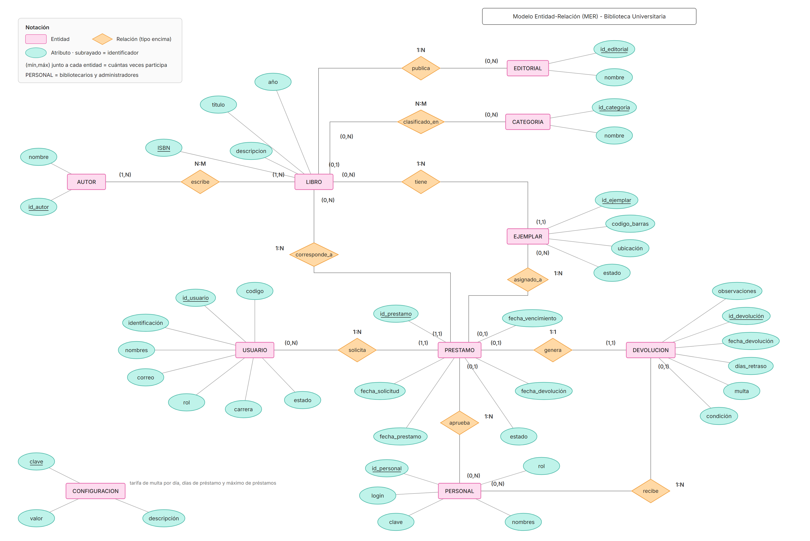
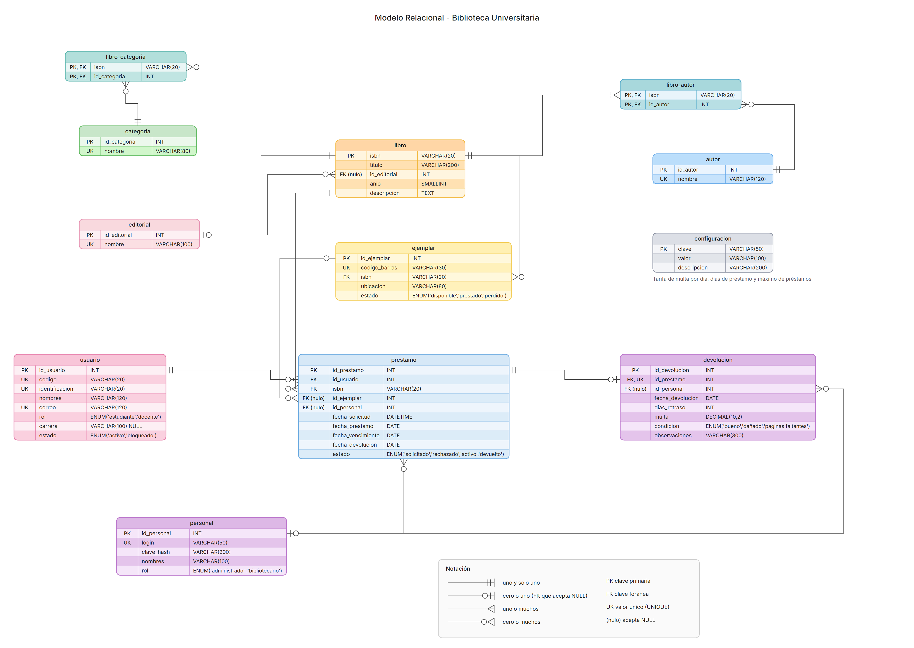
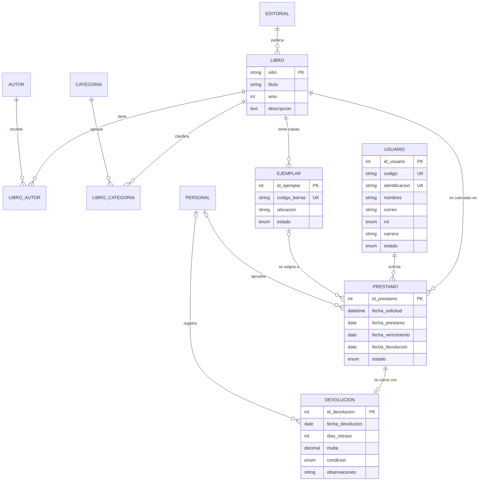

# Modelos de la base de datos

## Diagrama Entidad–Relación (MER)

Notación de Chen: entidades (rectángulos), relaciones (rombos, con su tipo encima), atributos (óvalos; subrayado = identificador) y cardinalidad (mín,máx) junto a cada entidad.
Fuente editable: [docs/fuentes/MER.html](docs/fuentes/MER.html) · versión Mermaid: [docs/mer.mmd](docs/mer.mmd).

## Diagrama Relacional

Notación de patas de gallo; PK = clave primaria, FK = clave foránea, UK = única, (nulo) = acepta NULL.
Fuente editable: [docs/fuentes/Modelo_Relacional.html](docs/fuentes/Modelo_Relacional.html) · versión Mermaid: [docs/relacional.mmd](docs/relacional.mmd).

---

## Versión en texto del MER

# Modelo Relacional

- EDITORIAL(**id_editorial**, nombre)
- AUTOR(**id_autor**, nombre)
- CATEGORIA(**id_categoria**, nombre)
- LIBRO(**isbn**, titulo, #id_editorial, anio, descripcion)
- LIBRO_AUTOR(**#isbn, #id_autor**)
- LIBRO_CATEGORIA(**#isbn, #id_categoria**)
- EJEMPLAR(**id_ejemplar**, codigo_barras, #isbn, ubicacion, estado)
- USUARIO(**id_usuario**, codigo, identificacion, nombres, correo, rol, carrera, estado)
- PERSONAL(**id_personal**, login, clave_hash, nombres, rol)
- PRESTAMO(**id_prestamo**, #id_usuario, #isbn, #id_ejemplar, #id_personal, fecha_solicitud, fecha_prestamo, fecha_vencimiento, fecha_devolucion, estado)
- DEVOLUCION(**id_devolucion**, #id_prestamo, #id_personal, fecha_devolucion, dias_retraso, multa, condicion, observaciones)
- CONFIGURACION(**clave**, valor, descripcion)  — tarifa de multa por día, días de préstamo, máximo de préstamos

(**negrita** = PK, # = FK)
